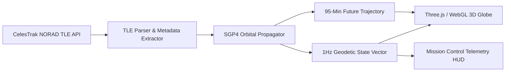

# OrbitPulse — Real-Time 3D Orbital Telemetry & SGP4 Tracker

A real-time astrodynamics and orbital telemetry console that ingests live NORAD Two-Line Element (TLE) datasets and propagates spacecraft state vectors at 1Hz using **SGP4 orbital mechanics** on an interactive WebGL 3D globe.

---

## System Architecture



## Key Engineering Highlights
* **Client-Side SGP4 Propagation:** Computes real-time Earth-Centered Inertial (ECI) to Geodetic ($\text{Lat}, \text{Lon}, \text{Alt}$) coordinate transformations and scalar orbital velocity at 1Hz via `satellite.js`.
* **Predictive Ground-Track Modeling:** Integrates forward orbital state vectors over a 95-minute window (~1 full Low Earth Orbit revolution) to render future trajectory arcs.
* **Zero-Downtime Ephemeris Pipeline:** Fetches live NORAD TLE feeds from CelesTrak with automatic fallback to cached orbital elements.
* **Target Lock Camera System:** Smoothly interpolates 3D camera coordinates to track Low Earth Orbit spacecraft traveling at ~7.66 km/s.

## Local Setup

```bash
git clone [https://github.com/Lalithya-prav/orbit-pulse.git](https://github.com/Lalithya-prav/orbit-pulse.git)
cd orbit-pulse
npm install
npm run dev
```

Open `http://localhost:5173` in your browser to launch the telemetry console.

## Project Structure

```text
orbit-pulse/
├── src/
│   ├── components/
│   │   ├── GlobeView.jsx      # Full-viewport 3D WebGL Earth, markers & orbital arcs
│   │   └── TelemetryHUD.jsx   # Mission control HUD, object selector & target lock
│   ├── utils/
│   │   └── orbitalMath.js     # TLE parser, SGP4 propagator & ground-track generator
│   ├── App.jsx                # 1Hz real-time propagation loop & CelesTrak feed
│   └── main.jsx
├── package.json
└── vite.config.js
```

## Tech Stack
* **Frontend:** React, Vite, Tailwind CSS
* **3D Rendering:** `react-globe.gl`, Three.js / WebGL
* **Astrodynamics:** `satellite.js` (SGP4/SDP4 implementation)

  
